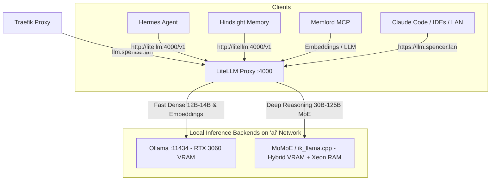

# Hybrid Mixture-of-Experts (MoE) Inference for Spencer's Homelab

**Status:** Implemented / Deployed (64k Unified MoE with KV Streaming)
**Date:** 2026-11-07
**Reference Projects:**
- [Niko1221/Strata](https://github.com/Niko1221/Strata)
- [aflin/momoe (MoMoE)](https://github.com/aflin/momoe)
- [ikawrakow/ik_llama.cpp](https://github.com/ikawrakow/ik_llama.cpp)
- [kvcache-ai/ktransformers](https://github.com/kvcache-ai/ktransformers)

---

## 1. Executive Summary

Projects like **Strata**, **MoMoE** (an open-source fork of Strata with broader model support), **KTransformers**, and **ik_llama.cpp** are **hybrid Mixture-of-Experts (MoE) inference engines**.

Instead of treating GPU VRAM as a hard capacity limit—or suffering severe PCIe bottlenecks when dense model layers spill into host memory—these engines exploit the sparse activation topology of MoE models:
- A model may contain **30B to 125B+ total parameters**, but only activates **2B to 8B parameters per generated token**.
- By pinning **attention layers, the KV cache, and "hot" (frequently routed) experts** inside GPU VRAM while keeping the remaining "cold" experts in **system RAM (or NVMe)** and utilizing speculative **Multi-Token Prediction (MTP)**, they run frontier-class MoE models at interactive speeds on a single consumer GPU.

---

## 2. Homelab Hardware Fit Analysis

### Current Host Specifications
| Component | Specification | Current Utilization in AI Stack |
| :--- | :--- | :--- |
| **Compute GPU** | NVIDIA GeForce RTX 3060 (**12 GB VRAM**) | Primary bottleneck for dense models (`gemma4:12b`, `qwen2.5:14b`) |
| **Display GPU** | NVIDIA Quadro K620 (2 GB VRAM) | Display / secondary card |
| **System Memory** | **61 GiB DDR4** (~51 GiB free/available) | Mostly idle during LLM inference |
| **Processor** | **Intel Xeon W-2145** (8C / 16T @ 3.70 GHz) | Workstation CPU with **quad-channel memory bandwidth** and **AVX-512** |
| **Storage** | `/data` LVM Volume (**~449 GB free**) | Ample capacity for 40–80 GB GGUF / quantized MoE weights |

### Why This Hardware Profile Is a Sweet Spot
1. **Breaking the 12 GB VRAM Ceiling**: With dense models in [Ollama](../../docs/ollama.md), you are effectively capped at **12B–14B models** before quantized weights plus a 32k–64k KV cache overflow the RTX 3060's 12 GB VRAM. Meanwhile, **~51 GiB of system RAM sits unused**.
2. **Quad-Channel Xeon + AVX-512 Advantage**: The Intel Xeon W-2145 supports quad-channel DDR4 memory and hardware AVX-512 instructions. Because hybrid MoE engines execute cold-expert matrix multiplications directly on the CPU in system RAM (or stream tiered experts across PCIe), quad-channel memory bandwidth + AVX-512 roughly **doubles CPU-side expert throughput** compared to standard dual-channel consumer desktops.
3. **70B–120B Intelligence at 3B–6B Compute Cost**: You can load **30B to 120B+ parameter MoE models** across your **51 GiB free RAM + 12 GB VRAM**, achieving frontier-tier reasoning and coding accuracy while paying the per-token compute cost of a small active parameter footprint.

---

## 3. Benefits to the Homelab Architecture

### A. Drop-In Backend Behind LiteLLM (`llm.spencer.lan`)
All homelab AI traffic is already unified behind [LiteLLM Proxy](../../docs/litellm.md) ([`litellm/config.yaml`](../../litellm/config.yaml)). Because both **Strata** and **MoMoE** expose local **OpenAI-compatible (`/v1/chat/completions`)** and **Anthropic-compatible (`/v1/messages`)** endpoints:
- Deploy MoMoE / Strata / `ik_llama.cpp` as a container on the internal `ai` Docker bridge network.
- Register the backend in `litellm/config.yaml` (e.g., `model_name: local-moe-large`).
- Every downstream service automatically gains access with centralized key management, PostgreSQL (`pgvector`) spend/prompt logging, and Authentik OIDC SSO protection intact.

### B. Stronger Autonomous Loops in Hermes Agent
[Hermes Agent](../../docs/hermes.md) relies heavily on multi-step tool calling, MCP orchestration, and Docker sandbox code execution. Dense 12B–14B models can occasionally lose track of complex JSON tool schemas or multi-turn debugging loops over 64k contexts. Routing complex tasks to a large local MoE model gives Hermes significantly stronger planning and coding reliability without sending private homelab data to external cloud providers (Groq, OpenRouter, DeepSeek).

### C. Higher-Quality Memory Synthesis in Hindsight & Memlord
[Hindsight](../../docs/hindsight.md) and [Memlord](../../docs/memlord.md) perform background entity extraction, fact deduplication, and reflective memory synthesis. Because background consolidation jobs are asynchronous and not latency-sensitive to the millisecond, running them against a large local MoE model produces cloud-grade knowledge extraction at zero API cost.

### D. Local Anthropic/OpenAI Harness for Claude Code & Developer Tools
Both Strata and MoMoE natively implement the **Anthropic Messages API (`/v1/messages`)** alongside OpenAI's `/v1/chat/completions`, specifically tuned for agentic coding harnesses (Claude Code, Cursor, OpenCode, Aider). Exposed through LiteLLM (`https://llm.spencer.lan`), any workstation on `.spencer.lan` can connect to a local 100B+ MoE coding assistant.

---

## 4. Engine Landscape & Comparison

| Project | Best For | Pros on Homelab Hardware | Trade-offs |
| :--- | :--- | :--- | :--- |
| **[aflin/momoe](https://github.com/aflin/momoe)** *(Recommended over base Strata)* | Running multiple modern MoE families on 1 GPU + RAM | MIT-licensed fork of Strata; supports Qwen MoE variants, GLM-Flash, Nemotron, Gemma, and LFM; built-in OpenAI & Anthropic API server | Younger codebase than `llama.cpp`; best run as a dedicated single-model service |
| **[Niko1221/Strata](https://github.com/Niko1221/Strata)** | Flagship massive MoE (specifically Qwen3.8-Flash-Next 125B) | Aggressive expert tiering (VRAM → RAM → NVMe) + Multi-Token Prediction (MTP) draft acceleration | Narrower model catalog out of the box compared to `momoe` |
| **[ik_llama.cpp](https://github.com/ikawrakow/ik_llama.cpp)** | Maximum stability & GGUF ecosystem compatibility | Uses standard GGUFs; supports `-ot exps=CPU` (pins attention/KV on RTX 3060, offloads MoE experts to Xeon AVX-512 RAM); rock-solid in Docker | Requires manual CLI flag tuning (`-ngl`, `-ot`) per model rather than automatic expert caching |
| **[KTransformers](https://github.com/kvcache-ai/ktransformers)** | Ultra-massive MoEs (e.g., DeepSeek-R1/V3 671B) | Specifically optimizes AVX-512 CPU kernels (ideal for Xeon W-2145) + CUDA attention | Full 671B still requires ~250 GB+ RAM (or heavy NVMe thrashing); heavier container image |

---

## 5. Architectural Trade-Offs & VRAM Coexistence with Ollama

Because the host has a single **RTX 3060 (12 GB VRAM)** for compute, running **Ollama** and a **Hybrid MoE Engine** simultaneously requires coordinating GPU memory:

1. **The Contention Challenge**:
   - **Ollama** keeps dense models resident in VRAM for its `keep_alive` window (default 5m) and serves `nomic-embed-text` for [Memlord](../../docs/memlord.md) and [Hindsight](../../docs/hindsight.md).
   - **MoMoE / Strata / `ik_llama.cpp`** wants to pin a dedicated slice of VRAM (typically 6–9 GB) for hot experts, attention layers, and the KV cache.

2. **Recommended Coexistence Strategies**:
   - **Strategy A — Partitioned VRAM Reservation (Always-On MoE + Embeddings)**:
     Configure the MoE engine to cap its VRAM footprint at **~8–9 GB**, leaving **~3 GB VRAM headroom** on the RTX 3060. This allows `ollama` to keep `nomic-embed-text` (~400 MB VRAM) permanently resident for Memlord/Hindsight without out-of-memory (OOM) errors.
   - **Strategy B — On-Demand Dense vs. MoE Routing**:
     Set `OLLAMA_KEEP_ALIVE=1m` (or `0` for chat models) when testing large MoE workloads, and configure model aliases in `litellm/config.yaml` (`fast-local` → Ollama dense model vs. `deep-local` → MoMoE hybrid model).

---

## 6. Implementation & Testing Roadmap

- [x] **Phase 1: Candidate Model & Engine Selection**
  - Selected **MoMoE (`aflin/momoe`)** compiled natively for NVIDIA RTX 3060 (`sm_86`) with automated expert tiering + Multi-Token Prediction (MTP).
  - Selected **Ornith-1.5-35B-A3B (`IQ4_XS`, ~19 GB)** as the initial MoE model (`MOMOE_FAMILY=ornith`, `MOMOE_MODEL=IQ4_XS`), leaving `VRAM_RESERVE_MIB=2560` (2.5 GiB) free on the RTX 3060 so Ollama (`nomic-embed-text`) can coexist without OOM.
- [x] **Phase 2: Docker Service Deployment**
  - Cloned `aflin/momoe` into `./momoe/src` with persistent data/packs/models mounted at `./momoe/data:/data` and custom container entrypoint at `./momoe/docker-entrypoint.sh`.
  - Added the `momoe` service to [`docker-compose.yaml`](../../docker-compose.yaml) on the internal `ai` network (`http://momoe:8080/v1`) and documented in [`docs/momoe.md`](../../docs/momoe.md).
- [x] **Phase 3: LiteLLM Integration & Benchmarking**
  - Registered `ornith-1.5-35b` and `momoe` in [`litellm/config.yaml`](../../litellm/config.yaml) alongside `gemma4:12b` (`default`) and `qwen2.5:14b`.
  - **Measured Live Benchmark (`Ornith-1.5-35B-A3B IQ4_XS` on RTX 3060 12 GB + Xeon W-2145 61 GiB RAM)**:
    - **Generation Speed (Decode + MTP Speculative Drafting)**: **112.5 tokens/sec** (300 tokens in 2.96s via LiteLLM)
    - **Expert Cache Hit Rate**: **73.0%** in GPU VRAM (`3,857` experts in `6.00 GiB` VRAM cache, `+1.4%` routed over PCIe from `15.94 GiB` locked host RAM arena loaded at `9.27 GiB/s`)
    - **Memory Footprint**: `9,389 MiB` VRAM used (`2,523 MiB` VRAM free on RTX 3060); `28 GiB` host RAM used (`33 GiB` RAM available)
- [x] **Phase 4: 64k Context & Multi-Agent Hardening**
  - Upgraded context window to **65,536 tokens** (`MOMOE_CONTEXT=65536`) with KV streaming across the 61 GiB DDR4 RAM arena.
  - Aligned LiteLLM with `mode: chat`, `max_tokens: 65536`, `max_input_tokens: 57344`, and dynamic `MOMOE_API_KEY` credential forwarding.
  - Aligned with Hermes Agent Firecrawl web scraping, ending VRAM collisions between Gemma 4 and MoMoE.
