# Spencer's Homelab Reverse Proxy, LLM Runtime & AI Agent Stack

A production-grade, privacy-first local homelab environment orchestrating edge routing, local LLM inference, autonomous agents, metasearch, headless browser rendering, and web scraping with **Docker Compose**.

---

## 🧭 In-Depth Documentation Directory

Detailed architectural designs, configuration options, environment variables, and troubleshooting guides for each individual service are located in the [`docs/`](docs/README.md) directory:

| Service | Role | Ingress & Internal Endpoints | Detailed Guide |
|---|---|---|---|
| **Traefik** | Reverse proxy, SSL, Geoblock (US Only) & edge router | `:80`, `:443` (`https://traefik.spencer.lan`) | [Traefik Guide](docs/traefik.md) |
| **CrowdSec** | Intrusion detection & Traefik Bouncer plugin | `:8080` (Internal `net1` network) | [CrowdSec Guide](docs/crowdsec.md) |
| **OmniRoute Gateway** | Universal AI gateway, OpenAI/Anthropic proxy & dynamic router (Standalone) | `https://llm.spencer.lan` (:20128) | [OmniRoute Guide](docs/omniroute.md) |
| **Open WebUI** | Multi-model generative AI chat & memory client (Fernet valve encryption at rest) | `https://chat.spencer.lan` / `https://ai.spencer.lan` (:8080) | [Open WebUI Guide](docs/open-webui.md) |
| **Open Terminal** | Sandboxed remote shell & agent execution substrate (OpenBao, GitHub & Gitea CLIs pre-installed) | `:8000` (Internal `ai` network) | [Open Terminal Guide](docs/open-terminal.md) |
| **Llama.cpp Server** | Hybrid MoE LLM inference engine (--n-cpu-moe GPU + RAM) | `:8080` (Internal `ai` network) | [Llama.cpp Guide](docs/llama-cpp.md) |
| **Llama.cpp Embed** | Zero-VRAM text embedding runtime (CPU AVX-512) | `:8081` (Internal `ai` network) | [Llama.cpp Guide](docs/llama-cpp.md#mounted-volumes--models) |
| **pgvector** | Unified vector & relational DB (Open WebUI relational + knowledge, Authentik & Gitea) | `pgvector:5432` (Internal `db` network) | [pgvector Guide](docs/pgvector.md) |
| **Firecrawl Stack** | Web scraper, crawler, and search backend | `http://firecrawl:3002` (Internal `ai` network) | [Firecrawl Guide](docs/firecrawl.md) |
| **SearXNG** | Privacy-respecting metasearch engine | `http://searxng:8080` (Internal `ai` network) | [SearXNG Guide](docs/searxng.md) |
| **Valkey** | High-performance in-memory cache & rate limiter | `valkey:6379` (Internal `redis` network) | [Valkey Guide](docs/valkey.md) |
| **Authentik** | Centralized IAM, SSO, OIDC & Proxy Outposts | `https://sso.spencer.lan` / `https://login.spencer.lan` (:9000) | [Authentik Guide](docs/authentik.md) |
| **Dozzle** | Real-time container log viewer & streamer | `https://logs.spencer.lan` / `https://dozzle.spencer.lan` | [Dozzle Guide](docs/dozzle.md) |
| **ntfy** | Push notification gateway & system alerts | `https://push.spencer.lan` / `https://ntfy.spencer.lan` | [ntfy Guide](docs/ntfy.md) |
| **OpenBao** | Identity-based secrets & encryption management | `https://vault.spencer.lan` / `https://openbao.spencer.lan` (:8200) | [OpenBao Guide](docs/openbao.md) |
| **Gitea** | Self-hosted Git platform & issue tracker | `https://git.spencer.lan` / `https://gitea.spencer.lan`, `:2222` (SSH) | [Gitea Guide](docs/gitea.md) |
| **Homepage** | Centralized dashboard & service health monitor | `https://home.spencer.lan` / `https://homepage.spencer.lan` | [Homepage Guide](docs/homepage.md) |
| **Glances** | Hardware telemetry & NVIDIA GPU performance monitor | `https://glances.spencer.lan` / `https://stats.spencer.lan` (:61208) | [Glances Guide](docs/glances.md) |
| *Legacy Stack* | *Archived / Retired Legacy Services* | *Reclaimed ~1.02 GB RAM* | [Legacy Stack Archive](docs/archive/open-webui-legacy-stack.md) |

---

## 🏗️ Architecture Overview

```mermaid
flowchart TB
    %% External Ingress & Security
    subgraph Edge ["🌐 Edge Ingress & Security"]
        Client([External & LAN Clients]) -->|HTTPS :443| Traefik[Traefik Reverse Proxy]
        Traefik <--> GeoPlugin[Geoblock Plugin\nUS Only & RFC1918]
        Traefik <--> BouncerPlugin[CrowdSec Bouncer\nStream Mode]
        Traefik -.->|Access Logs| CrowdSec[CrowdSec Security Engine]
        Traefik <-->|ForwardAuth| Authentik[Authentik Server\nIAM & Outpost :9000]
    end

    %% Exposed Ingress Routes (net1)
    subgraph Ingress ["🚪 Proxied Endpoints (net1)"]
        Traefik -->|sso / login| Authentik
        Traefik -->|chat / ai| OpenWebUI["Open WebUI :8080"]
        Traefik -->|llm| OmniRouteUI["OmniRoute :20128"]
        Traefik -->|logs| DozzleUI["Dozzle :8080"]
        Traefik -->|push| Ntfy["ntfy :80"]
        Traefik -->|vault| OpenBaoUI["OpenBao :8200"]
        Traefik -->|git| GiteaUI["Gitea :3000"]
        Traefik -->|home| HomeUI["Homepage :3000"]
        Traefik -->|glances / stats| GlancesUI["Glances :61208"]
        Traefik -->|traefik| TraefikDash["Traefik :internal"]
    end

    %% AI Agent & Inference Layer
    subgraph AICore ["🧠 AI Agent & Inference Layer (ai)"]
        LlamaServer["llama-server Hybrid MoE\n(RTX 3060 12GB + RAM AVX-512 :8080)"]
        LlamaEmbed["llama-embed Zero-VRAM Embeddings\n(CPU nomic-embed-text :8081)"]
        OmniRoute["OmniRoute AI Gateway (Standalone)\n(Universal Router, Optimizer & Cache :20128)"]
        OpenTerminal["Open Terminal Sandbox\n:8000 (Agent Shell & Files)"]
        
        OpenWebUI -->|Direct Chat :8080/v1| LlamaServer
        OpenWebUI -->|Direct Embeddings :8081/v1| LlamaEmbed
        OpenWebUI -->|Remote Shell & Workspace| OpenTerminal
        OmniRoute -.->|Optional Upstream Inference| LlamaServer
        OmniRoute -.->|Optional Cloud Fallbacks| CloudLLM[OpenRouter / Groq / DeepSeek]
    end

    %% Tools, Search & Scraping Cluster
    subgraph Tools ["🛠️ Tools, Search & Scraping Cluster"]
        SearXNG["SearXNG Metasearch\n:8080 (ai / redis)"]
        
        subgraph FirecrawlStack ["Firecrawl Scraping Cluster (:3002)"]
            Firecrawl["Firecrawl Engine"]
            Playwright["Playwright Service\n:3000"]
            RabbitMQ["RabbitMQ Broker\n:5672"]
            NuqPG[("NuQ-Postgres\n:5432")]
            Firecrawl --> Playwright
            Firecrawl --> RabbitMQ
            Firecrawl --> NuqPG
        end

        OpenWebUI -->|Web Search| SearXNG
        Firecrawl -->|Direct Search Backend| SearXNG
    end

    %% Data Plane & Storage
    subgraph DataPlane ["💾 Data & Caching Plane"]
        subgraph DBNet ["db Network"]
            PGVector[("pgvector Database\n(openwebui, openwebui_knowledge, authentik & gitea)")]
        end
        subgraph CacheNet ["redis Network"]
            Valkey[("Valkey In-Memory Cache\n(Search Cache & Rate Limiting)")]
        end
    end

    OpenWebUI -->|Memory & Vectors| PGVector
    OmniRoute <-->|Cache & Rate Limiting| Valkey
    SearXNG -->|Result Cache| Valkey
    Firecrawl -->|Rate Limiting| Valkey
```



---

## 📁 Repository Structure

```text
/data/homelab/
├── docker-compose.yaml      # Master multi-container Compose manifest
├── README.md                # Main system summary and quickstart
├── CHANGELOG.md             # Date-based record of environment changes
├── TODO.md                  # Homelab roadmap and upcoming initiatives
├── AGENTS.md                # Workspace operational guidelines for AI agents
├── .env                     # Local environment secrets and configuration
├── .env.example             # Template file with documentation of all variables
├── 0-projects/              # Architecture initiatives & research spikes (e.g. MoE)
├── crowdsec/                # CrowdSec intrusion detection configs & databases
│   ├── config/              # CrowdSec engine & log acquisition rules (acquis.d/)
│   └── data/                # SQLite event database and local intelligence store
├── docs/                    # Detailed service documentation
│   ├── README.md            # Documentation directory index
│   ├── authentik.md         # Authentik centralized IAM & SSO guide
│   ├── crowdsec.md          # CrowdSec security engine & Traefik bouncer guide
│   ├── dozzle.md            # Dozzle real-time container log viewer guide
│   ├── firecrawl.md         # Firecrawl architecture, queues & scraping
│   ├── gitea.md             # Gitea Git repository manager & issue tracker guide
│   ├── homepage.md          # Homepage service directory & health dashboard guide
│   ├── momoe.md             # MoMoE hybrid MoE 64k inference engine guide
│   ├── ntfy.md              # ntfy push notification gateway guide
│   ├── ollama.md            # Ollama setup & GPU acceleration guide
│   ├── omniroute.md         # OmniRoute universal AI gateway, proxy & optimizer guide
│   ├── openbao.md           # OpenBao secrets & encryption management guide
│   ├── open-terminal.md     # Open Terminal agent execution sandbox guide
│   ├── open-webui.md        # Open WebUI generative chat & memory client guide
│   ├── pgvector.md          # Dedicated pgvector database for Open WebUI (core + knowledge), Authentik & Gitea
│   ├── searxng.md           # SearXNG configuration & JSON engine setup
│   ├── traefik.md           # Traefik reverse proxy, SSL & bouncer plugin
│   ├── valkey.md            # Valkey caching & healthcheck operations
│   └── archive/             # Archived service guides (litellm, hermes, hindsight, memlord)
├── authentik/               # Authentik configuration, media and templates
├── gitea/                   # Gitea repositories, git data and configs
├── homepage/                # Homepage service dashboard layout & configs
├── momoe/                   # MoMoE hybrid MoE engine data, packs & entrypoint
│   ├── data/                # Downloaded GGUF weights, packs, configs and logs
│   └── docker-entrypoint.sh # Container startup orchestrator & CLI pass-through
├── ntfy/                    # ntfy notification cache & persistent alert store
├── nuq-postgres/            # NuQ PostgreSQL persistent crawl state database
├── ollama/                  # Cached LLM model weights
├── omniroute/               # OmniRoute persistent SQLite data & secrets
│   └── data/                # SQLite database (storage.sqlite), cache & server env
├── openbao/                 # OpenBao server configuration & Raft storage
│   ├── config/              # OpenBao server configuration (bao.hcl)
│   └── data/                # Persistent Raft transactional database
├── open-terminal/           # Open Terminal container configuration & workspace
│   ├── Dockerfile           # Custom image recipe embedding developer CLIs (bao, gh, gt, tea)
│   └── workspace/           # Persistent agent home directory (/home/user)
├── open-webui/              # Open WebUI runtime data, vectors and user uploads
├── pgvector/                # Dedicated pgvector database data & init scripts
├── scripts/                 # Maintenance, notification & operational automation
├── searxng/                 # SearXNG configuration and cache directories
├── traefik/                 # Traefik static, dynamic, and TLS cert configurations
│   ├── certs/               # Wildcard SSL certificates (*.spencer.lan)
│   ├── dynamic.yml          # Dynamic routers, TLS & bouncer middleware
│   ├── logs/                # Traefik JSON access log (read by CrowdSec)
│   ├── traefik.yml          # Static entrypoints, plugins & log declarations
│   └── crowdsec_bouncer_key # Protected secret key file for bouncer plugin
└── valkey/                  # Valkey snapshot persistence directory
```

---

## 🚀 Quick Start

### 1. Prerequisites
* **Docker & Docker Compose**: Compose v2 installed.
* **NVIDIA Container Toolkit**: Required for hardware GPU acceleration on Ollama.
* **Local DNS**: `*.spencer.lan` pointed to your host IP address.
* **TLS Certificates**: Wildcard certificates in `traefik/certs/cert.pem` and `traefik/certs/key.pem`.

### 2. Environment Setup
Copy the template and adjust passwords or API keys as needed:
```bash
cp .env.example .env
```

### 3. Start the Stack
```bash
docker compose up -d
```

### 4. Verify Service Health
```bash
docker compose ps
```

---

## 🧪 Operational Commands & Health Checks

### Check Traefik Routing
Navigate to `https://traefik.spencer.lan` or check logs:
```bash
docker compose logs -f traefik
```

### Test OmniRoute AI Gateway
```bash
curl -kfsSL https://llm.spencer.lan/healthz
curl -kfsSL https://llm.spencer.lan/v1/models -H "Authorization: Bearer ${OMNIROUTE_MASTER_KEY}"
```

### Test Llama.cpp MoE GPU Inference
```bash
docker compose exec llama-server curl -s http://localhost:8080/health
docker compose exec open-webui curl -s http://llama-server:8080/v1/models
nvidia-smi
```

### Test Llama.cpp Embedding Service
```bash
docker compose exec llama-embed curl -s http://localhost:8081/health
docker compose exec open-webui curl -s http://llama-embed:8081/v1/models
```

### Test Internal Scraping (Firecrawl)
```bash
docker compose exec open-webui curl -s -X POST http://firecrawl:3002/v1/scrape \
  -H "Content-Type: application/json" \
  -d '{"url":"https://example.com"}'
```

### Test Internal Search (SearXNG)
```bash
docker compose exec open-webui curl -s "http://searxng:8080/search?q=docker&format=json"
```

### Test Database Readiness
```bash
docker compose exec pgvector pg_isready -U postgres -d postgres
```

### Test OpenBao Vault Status
```bash
docker compose exec openbao bao status
```
