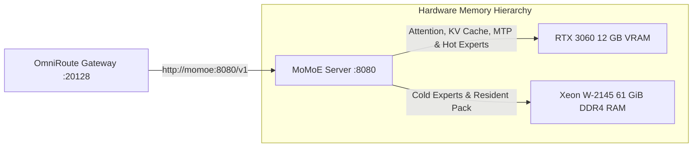

# MoMoE - Hybrid Mixture-of-Experts (MoE) Inference Engine

MoMoE ([`aflin/momoe`](https://github.com/aflin/momoe), a fork of [`Niko1221/Strata`](https://github.com/Niko1221/Strata)) provides high-speed local Mixture-of-Experts (MoE) LLM inference by combining GPU VRAM (for attention layers, KV cache, MTP draft layers, and hot experts) with host system RAM and AVX-512 CPU execution (for cold experts).

---

## 🎯 Overview & Architecture

* **Role**: Hybrid VRAM + RAM Mixture-of-Experts (MoE) inference backend behind OmniRoute AI Gateway.
* **Container Name**: `momoe`
* **Image**: `homelab/momoe:latest` (built locally from `./momoe/src` for NVIDIA `sm_86` RTX 3060)
* **Network**: `ai` (Internal AI communication network; no host ports exposed)
* **Internal Port**: `8080`
* **API Endpoints**:
  * OpenAI-Compatible API: `http://momoe:8080/v1`
  * Anthropic Messages API: `http://momoe:8080/v1/messages`
  * Health Check: `http://momoe:8080/health`



---

## ⚙️ Configuration & Default Model

Configured via environment variables in [`docker-compose.yaml`](../docker-compose.yaml) (and overridable in `.env`):

| Variable | Default | Purpose |
|---|---|---|
| `MOMOE_FAMILY` (`FAMILY`) | `ornith` | Model family (`ornith` = **Ornith-1.5-35B-A3B**, agentic coding fine-tune of Qwen3.6-35B-A3B) |
| `MOMOE_MODEL` (`MODEL`) | `IQ4_XS` | Quantization size (~19 GB GGUF download, ~128 tok/s with MTP drafting) |
| `MOMOE_CONTEXT` (`CONTEXT`) | `65536` | Maximum context window in tokens (64k enables large Firecrawl web scrapes in Open WebUI via KV streaming) |
| `MOMOE_VISION` (`VISION`) | `no` | Vision encoder (`no`, `yes`, or `cpu`) |
| `MOMOE_VRAM_RESERVE_MIB` (`VRAM_RESERVE_MIB`) | `2560` | Reserves 2.5 GiB of RTX 3060 VRAM so Ollama (`nomic-embed-text`) can coexist without OOM |
| `MOMOE_API_KEY` (`API_KEY`) | `momoe-local` | Internal API key used between OmniRoute Gateway and MoMoE |
| `STRATA_ALLOWED_HOSTS` | `momoe,localhost,127.0.0.1` | Whitelists internal Docker hostnames for MoMoE's HTTP server |
| `GPU` | `0` | Pins execution to GPU `0` (NVIDIA GeForce RTX 3060) |

---

## 🚀 GPU & Memory Coexistence with Ollama

Because the homelab shares a single **NVIDIA RTX 3060 (12 GB VRAM)** between `ollama` and `momoe`:
1. **VRAM Reservation (`VRAM_RESERVE_MIB=2560`)**: MoMoE leaves 2.5 GiB of VRAM untouched on the RTX 3060, ensuring `ollama` always has headroom to run `nomic-embed-text` (~400 MB VRAM) for Open WebUI RAG and conversational memory embeddings.
2. **Locked Host Memory (`ulimits.memlock: -1`)**: Allows MoMoE to pin expert arenas in the host's 61 GiB quad-channel DDR4 RAM for high-bandwidth PCIe transfers and AVX-512 CPU expert execution.

---

## 📁 Mounted Volumes & Files

| Host Path | Container Path | Purpose |
|---|---|---|
| `./momoe/src` | *(Build Context)* | Cloned `aflin/momoe` source repository |
| `./momoe/data` | `/data` | Persistent storage for downloaded `.gguf` models, prepared expert packs, configs (`config/`), and logs (`logs/`) |
| `./momoe/docker-entrypoint.sh` | `/opt/strata/docker-entrypoint.sh:ro` | Container entrypoint managing initial model setup and `VRAM_RESERVE_MIB` forwarding |

---

## 📦 Initial Deployment & Build Instructions

Because `./momoe/src/` contains upstream engine code and is excluded by `.gitignore`, provision a new host using these steps:

```bash
# 1. Clone the MoMoE upstream repository into momoe/src
git clone https://github.com/aflin/momoe.git momoe/src

# 2. Build the container image optimized for RTX 3060 (sm_86)
docker compose build momoe

# 3. Launch MoMoE (downloads Ornith-1.5-35B-A3B-IQ4_XS on initial start)
docker compose up -d momoe
```

> [!NOTE]
> Once MoMoE generates its runtime config (`/data/config/strata-ornith-iq4_xs.json`), changes to `CONTEXT`, `MODEL`, or `KV` in Compose are bypassed on warm container restarts. To force re-configuration (e.g. upgrading to a new context window), pass `REINSTALL=1` in your environment or delete the cached JSON file:
> ```bash
> REINSTALL=1 docker compose up -d momoe
> ```

---

## 🛠️ Management & Useful Commands

### Checking Container & Download / Model Status
On first start, `momoe` downloads `Ornith-1.5-35B-A3B-IQ4_XS.gguf` (~19 GB) into `./momoe/data/models/` and prepares the expert pack in `./momoe/data/packs/` before opening port `8080`:
```bash
docker compose logs -f momoe
```

### Checking Health & Active Model
```bash
docker compose exec momoe curl -s http://127.0.0.1:8080/health
docker compose exec momoe ./momoe status
```

### Testing via OmniRoute AI Gateway
MoMoE is registered in OmniRoute's provider registry (`provider: llama-cpp`) under both `ornith-1.5-35b` and `momoe`:
```bash
curl -s -k https://llm.spencer.lan/v1/chat/completions \
  -H "Authorization: Bearer $OMNIROUTE_MASTER_KEY" \
  -H "Content-Type: application/json" \
  -d '{
    "model": "momoe",
    "messages": [{"role": "user", "content": "Write a fast fib function in Python."}]
  }'
```

### Switching Model Families
To switch to another MoE family (e.g., `qwen36`, `qwen` Flash-Next 125B, `kat-coder`, `flint`, or `gemma4`), update `MOMOE_FAMILY` and `MOMOE_MODEL` in `.env` and recreate the container:
```bash
docker compose up -d momoe
```
