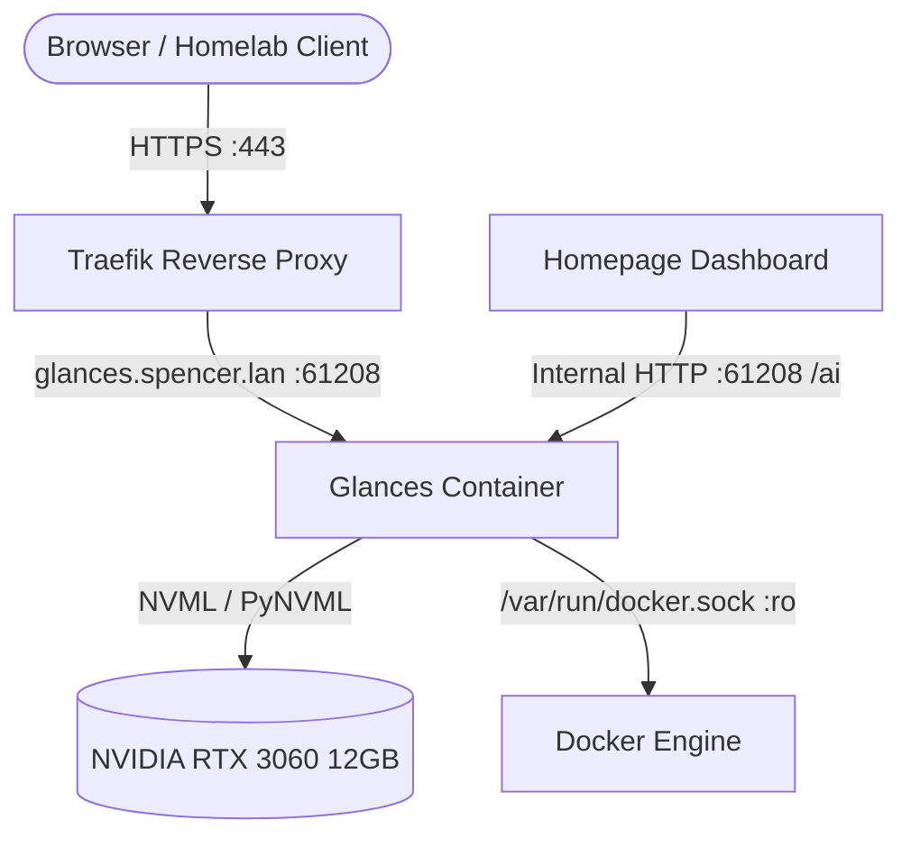

# Glances - Hardware Telemetry & GPU Performance Monitor

**Glances** ([GitHub](https://github.com/nicolargo/glances) / [Docs](https://nicolargo.github.io/glances/)) is an open-source, real-time system and hardware monitoring tool. In Spencer's Homelab, Glances runs with full NVIDIA GPU passthrough to monitor telemetry, utilization, VRAM allocation, temperature, and fan speed for the local **NVIDIA GeForce RTX 3060 12GB**, feeding live metrics into the **Homepage** dashboard and exposing a web UI via Traefik.

---

## 🎯 Architecture & System Context

* **Role**: System performance and NVIDIA GPU hardware telemetry agent.
* **Container Name**: `glances`
* **Image**: `nicolargo/glances:${GLANCES_VERSION:-ubuntu-latest-full}` (Ubuntu glibc base is required for NVML `/usr/lib/x86_64-linux-gnu/libnvidia-ml.so.1` host driver interoperability).
* **Networks**:
  * `net1`: Ingress network connected to Traefik reverse proxy (`glances.spencer.lan`, `stats.spencer.lan`).
  * `ai`: Isolated internal network enabling direct REST API polling by Homepage (`http://glances:61208`) without edge proxy overhead.
* **GPU Hardware Access**:
  * Configured with NVIDIA GPU device reservation (`driver: nvidia`, `count: all`, `capabilities: [gpu]`).
* **Socket & PID**:
  * `/var/run/docker.sock:/var/run/docker.sock:ro` (Read-only container monitoring).
  * `pid: host` (Host PID namespace mapping for accurate process tracking).
* **Ingress & URLs**:
  * LAN URL: `https://glances.spencer.lan`
  * Secondary LAN Alias: `https://stats.spencer.lan`
  * Internal API: `http://glances:61208`



---

## 🛠️ Configuration & Service Specification

### Docker Compose Service Definition

```yaml
  glances:
    image: nicolargo/glances:${GLANCES_VERSION:-ubuntu-latest-full}
    container_name: glances
    restart: unless-stopped
    pid: host
    volumes:
      - /var/run/docker.sock:/var/run/docker.sock:ro
    networks:
      - net1
      - ai
    environment:
      - GLANCES_OPT=-w
    deploy:
      resources:
        reservations:
          devices:
            - driver: nvidia
              count: all
              capabilities: [gpu]
    healthcheck:
      test: ["CMD-SHELL", "python3 -c \"import urllib.request; urllib.request.urlopen('http://localhost:61208/api/4/version')\" || exit 1"]
      interval: 15s
      timeout: 5s
      retries: 3
      start_period: 10s
    labels:
      - "traefik.enable=true"
      - "traefik.docker.network=net1"
      # Local LAN Router
      - "traefik.http.routers.glances.rule=Host(`glances.spencer.lan`) || Host(`stats.spencer.lan`)"
      - "traefik.http.routers.glances.entrypoints=websecure"
      - "traefik.http.routers.glances.tls=true"
      - "traefik.http.routers.glances.service=glances-svc"
      - "traefik.http.services.glances-svc.loadbalancer.server.port=61208"
```

---

## 📊 Homepage Integration

In [`homepage/config/services.yaml`](file:///data/homelab/homepage/config/services.yaml), Glances feeds live telemetry into two dashboard tiles:

1. **NVIDIA RTX 3060** (Under **AI & Agents**): Live GPU core utilization, VRAM usage %, temperature, and dual-line charts (`metric: gpu:nvidia0`).
2. **Host Performance** (Under **Developer Tools & Ops**): Live physical CPU load (user vs system) and system telemetry (`metric: cpu`).

```yaml
    # AI & Agents
    - NVIDIA RTX 3060:
        icon: nvidia.png
        href: https://glances.spencer.lan
        description: "12GB VRAM Local AI Hardware Accelerator"
        server: local-docker
        container: glances
        widget:
          type: glances
          url: http://glances:61208
          version: 4
          metric: gpu:nvidia0
          refreshInterval: 5000

    # Developer Tools & Ops
    - Host Performance:
        icon: glances.png
        href: https://glances.spencer.lan
        description: "Physical Host CPU, System Load & Processes"
        server: local-docker
        container: glances
        widget:
          type: glances
          url: http://glances:61208
          version: 4
          metric: cpu
          refreshInterval: 5000
```

> [!NOTE]
> In Glances REST API v4 (`/api/4/gpu`), NVIDIA devices report under the key `gpu_id` with identifier `nvidia0`. Homepage matches the suffix of `gpu:<gpu_id>` against `a[a.key]`, meaning `gpu:nvidia0` must be used rather than `gpu:0`.

---

## 🔍 Verification & Health Checks

Verify Glances container and API metrics with the following operational checks:

```bash
# 1. Check container health status
docker ps -f name=glances

# 2. Query Glances REST API v4 for GPU status (via container or service hostname)
docker exec glances curl -s http://localhost:61208/api/4/gpu | jq .

# 3. Test Homepage proxy endpoint resolution
curl -s -H "Host: home.spencer.lan" "http://localhost:3000/api/services/proxy?service=NVIDIA%20RTX%203060&group=AI%20%26%20Agents&endpoint=4/gpu" | jq .

# 4. Test Traefik routing
curl -k -s -o /dev/null -w "%{http_code}\n" https://127.0.0.1/ -H "Host: glances.spencer.lan"
```

