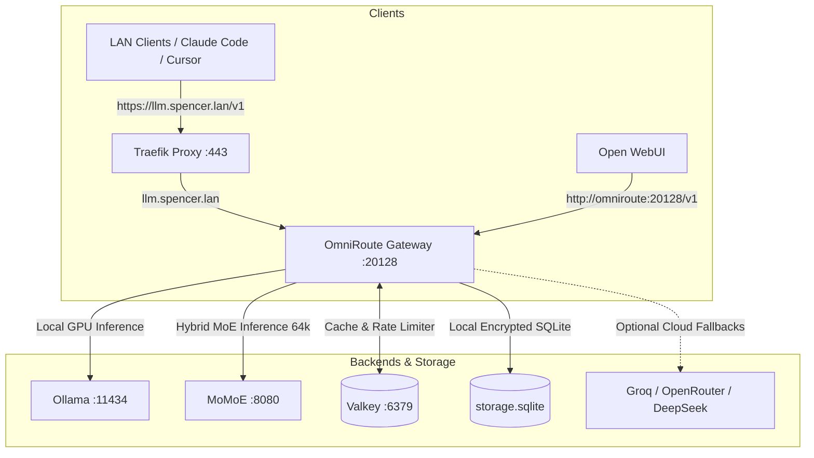

# OmniRoute AI Gateway - Centralized Homelab LLM Router

OmniRoute provides a unified, universal AI gateway, proxy, and dynamic model router supporting both OpenAI-compatible (`/v1/chat/completions`, `/v1/embeddings`) and Anthropic-compatible (`/v1/messages`) APIs for all local and cloud language models in Spencer's Homelab.

---

## 🎯 Overview & Architecture

* **Role**: Centralized LLM dispatch gateway, model router, prompt/token optimizer, and rate limiter.
* **Container Name**: `omniroute`
* **Image**: `diegosouzapw/omniroute:latest`
* **Networks**:
  * `net1`: Traefik reverse proxy ingress (`llm.spencer.lan`).
  * `ai`: Internal communication with Ollama (`ollama:11434`), MoMoE (`momoe:8080`), and Open WebUI (`open-webui:8080`).
  * `redis`: High-performance caching, token optimization, and distributed rate limiting via Valkey (`valkey:6379`).
* **External Ingress & Ports**:
  * API Endpoints: `https://llm.spencer.lan/v1` & `https://llm.spencer.lan/v1/messages`
  * Health Endpoint: `https://llm.spencer.lan/healthz`
  * Admin Dashboard UI: `https://llm.spencer.lan/dashboard`
  * Internal Service Port: `http://omniroute:20128/v1`



---

## ⚙️ Model Catalog & Routing

OmniRoute routes model requests across local hardware acceleration backends and optional cloud providers using declarative aliases and connection registry entries:

| Model Alias / ID | Target Provider | Target Backend | Capabilities |
|---|---|---|---|
| `gemma4:12b` | `ollama-local` | `http://ollama:11434/v1` | GPU-accelerated local instruction & tool calling (64k context) |
| `default` | `ollama-local` | `http://ollama:11434/v1` | Default homelab fallback model |
| `qwen2.5:14b` | `ollama-local` | `http://ollama:11434/v1` | GPU-accelerated local instruction & tool calling (32k context) |
| `nomic-embed-text` | `ollama-local` | `http://ollama:11434/v1` | High-performance text vector embeddings (768-dim) |
| `ornith-1.5-35b` / `momoe` | `llama-cpp` | `http://momoe:8080/v1` | Agentic coding & deep reasoning via MoMoE (64k KV streaming in RAM + MTP drafting) |
| `groq/llama-3.3-70b-versatile` | `groq` | Groq Cloud (`GROQ_API_KEY`) | Ultra-fast cloud fallback when local compute is saturated |
| `openrouter/auto` | `openrouter` | OpenRouter (`OPENROUTER_API_KEY`) | Flexible fallback routing to foundation models |
| `deepseek/deepseek-chat` | `deepseek` | DeepSeek (`DEEPSEEK_API_KEY`) | Cost-efficient large-context coding and reasoning |

---

## 🔒 Security, Authentication & Admin UI

1. **Master Key**:
   The master API key configured in `.env` (`OMNIROUTE_MASTER_KEY`) grants full access to programmatic API endpoints (`/v1/*`) and is used by internal consumers (Open WebUI) and LAN clients.
2. **Dashboard Authentication**:
   Access to the Web Dashboard at `https://llm.spencer.lan/dashboard` requires credentials configured via `INITIAL_PASSWORD` and managed within the interface.
3. **Encrypted Storage at Rest**:
   OmniRoute stores provider keys and connection tokens encrypted with AES-256-GCM (`API_KEY_SECRET`) in its embedded SQLite database (`/app/data/storage.sqlite`).
4. **Zero PostgreSQL Overhead**:
   Unlike legacy proxies, OmniRoute requires no relational database maintenance, table vacuuming, or spend log archival pipelines.

---

## 🔌 Client Integration

### 1. Open WebUI Integration
Open WebUI routes all chat generations and conversational embeddings through OmniRoute over the internal `ai` Docker network.
* **In `docker-compose.yaml`**:
  ```yaml
  environment:
    - OPENAI_API_BASE_URL=http://omniroute:20128/v1
    - OPENAI_API_KEY=${OMNIROUTE_MASTER_KEY}
    - RAG_EMBEDDING_ENGINE=openai
    - RAG_OPENAI_API_BASE_URL=http://omniroute:20128/v1
    - RAG_OPENAI_API_KEY=${OMNIROUTE_MASTER_KEY}
    - RAG_EMBEDDING_MODEL=nomic-embed-text
  depends_on:
    omniroute:
      condition: service_healthy
  ```

### 2. External Coding Agents (Claude Code, Cursor, Aider)
OmniRoute natively supports the Anthropic Messages API alongside OpenAI chat completions:
```bash
# OpenAI endpoint
export OPENAI_BASE_URL="https://llm.spencer.lan/v1"
export OPENAI_API_KEY="sk-spencer-..."

# Anthropic endpoint
export ANTHROPIC_BASE_URL="https://llm.spencer.lan/v1"
export ANTHROPIC_API_KEY="sk-spencer-..."
```

---

## 📁 Mounted Volumes & Persistence

| Host Path | Container Path | Purpose |
|---|---|---|
| `./omniroute/data` | `/app/data` | Persistent SQLite database (`storage.sqlite`), cache, and encrypted secrets |

---

## 🛠️ Verification & Health Checks

```bash
# 1. Healthcheck probe
curl -kfsSL https://llm.spencer.lan/healthz

# 2. Test chat completion via OmniRoute
curl -kfsSL -X POST https://llm.spencer.lan/v1/chat/completions \
  -H "Authorization: Bearer ${OMNIROUTE_MASTER_KEY}" \
  -H "Content-Type: application/json" \
  -d '{"model": "gemma4:12b", "messages": [{"role": "user", "content": "ping"}], "max_tokens": 10}'

# 3. Test embedding generation
curl -kfsSL -X POST https://llm.spencer.lan/v1/embeddings \
  -H "Authorization: Bearer ${OMNIROUTE_MASTER_KEY}" \
  -H "Content-Type: application/json" \
  -d '{"model": "nomic-embed-text", "input": "homelab test vector"}'

# 4. Open WebUI End-to-End Suite
python3 scripts/test-openwebui.py
```
