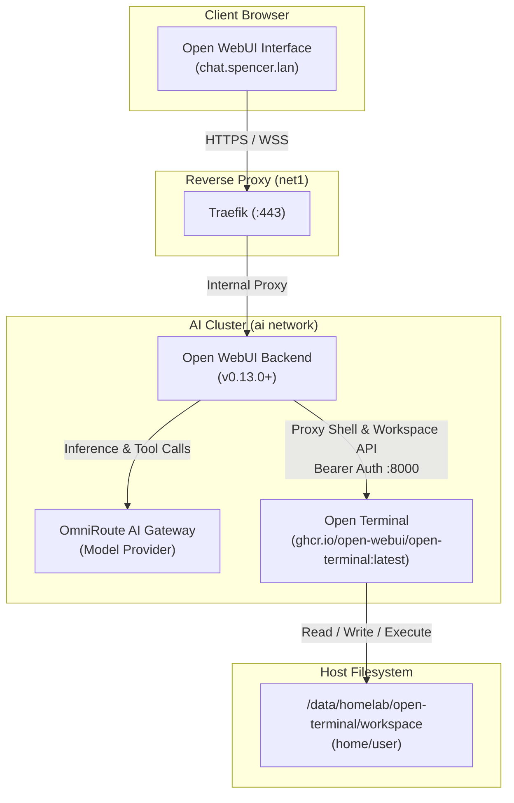

# Open Terminal Architecture & Operational Guide

This document provides architecture specifications, integration details, configuration parameters, and operational procedures for the **Open Terminal** service in Spencer's homelab.

---

## 📋 Overview

| Attribute | Specification |
|---|---|
| **Service Name** | `open-terminal` |
| **Container Name** | `open-terminal` |
| **Image** | `ghcr.io/open-webui/open-terminal:latest` |
| **Role** | Computer substrate & sandboxed remote shell execution environment for Open WebUI |
| **Internal Access** | `http://open-terminal:8000` (on internal `ai` network) |
| **Authentication** | Bearer Token API Key (`OPEN_TERMINAL_API_KEY`) |
| **Client / Consumer** | Open WebUI (`open-webui` container) |
| **Network Attachments** | `ai` (Internal AI & microservices network) |
| **Host Port Exposure** | None (Isolated internally; proxied by Open WebUI) |
| **Persistent Storage** | `/data/homelab/open-terminal/workspace` (`/home/user` in container) |
| **File Permissions** | UID:GID 1000:1000 (`suadmin`) |
| **Resource Limits** | 2 GB Memory limit / 512 MB reservation |

---

## 🏗️ Architecture & Interaction Flow

Open Terminal acts as the physical action layer for AI agents operating inside Open WebUI:



---

## ⚙️ Configuration & Environment Variables

Open Terminal is configured via environment variables in `/data/homelab/docker-compose.yaml`:

| Variable | Default / Value | Description |
|---|---|---|
| `OPEN_TERMINAL_API_KEY` | `${OPEN_TERMINAL_API_KEY}` | Secret bearer token required for API and shell execution access |
| `OPEN_TERMINAL_MAX_SESSIONS` | `16` | Maximum concurrent active terminal sessions |
| `OPEN_TERMINAL_ENABLE_TERMINAL` | `true` | Enables interactive PTY shell execution |
| `OPEN_TERMINAL_ENABLE_NOTEBOOKS` | `true` | Enables Jupyter notebook execution |
| `OPEN_TERMINAL_FILE_BROWSER_ROOT` | `home` | Visual file browser root set to `/home/user` |
| `OPEN_TERMINAL_PACKAGES` | `curl git jq tree` | Space-separated `apt` packages installed on container startup |
| `OPEN_TERMINAL_PIP_PACKAGES` | `httpx requests pydantic` | Space-separated Python packages installed via `pip` on startup |

---

## 🔗 Open WebUI Integration

1. In Open WebUI, navigate to **Settings > Admin > Integrations > Open Terminal**.
2. Set **URL** to: `http://open-terminal:8000`
3. Set **API Key** to: The value of `OPEN_TERMINAL_API_KEY` stored in `.env.passwords`.
4. Click **Save / Verify**.

When interacting with tool-enabled models (e.g., via OmniRoute), models can automatically invoke shell commands, edit files in the workspace, run scripts, and view generated outputs in dedicated UI panels.

---

## 🔒 Security & Sandbox Boundaries

* **Network Isolation**: Open Terminal resides strictly on the `ai` bridge network and is inaccessible directly from external hosts or public networks.
* **Non-Root Execution**: Runs under standard user UID 1000 inside the container.
* **No Docker Socket Mounting**: Avoids mounting `/var/run/docker.sock` to prevent container breakout risks.
* **Credential Hygiene**: The API key is stored strictly in `.env` and `.env.passwords`, excluded by `.gitignore`.

---

## 🧪 Health & Diagnostic Commands

### Check Health Status
```bash
docker compose ps open-terminal
docker inspect open-terminal --format '{{json .State.Health.Status}}'
```

### Probe Endpoint from Open WebUI
```bash
docker exec open-webui python3 -c "import urllib.request; print(urllib.request.urlopen('http://open-terminal:8000/health').read().decode())"
```

### Inspect Container Logs
```bash
docker logs open-terminal --tail 50
```
