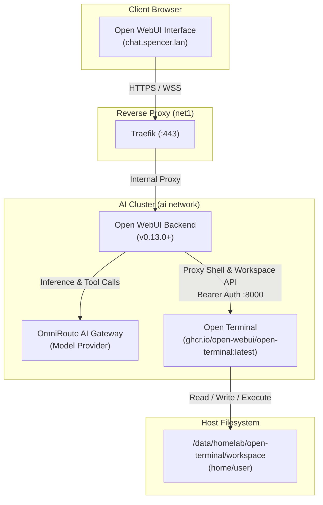

# Open Terminal Architecture & Operational Guide

This document provides architecture specifications, integration details, configuration parameters, and operational procedures for the **Open Terminal** service in Spencer's homelab.

---

## 📋 Overview

| Attribute | Specification |
|---|---|
| **Service Name** | `open-terminal` |
| **Container Name** | `open-terminal` |
| **Image** | `homelab/open-terminal:latest` (built from `./open-terminal/Dockerfile`) |
| **Role** | Computer substrate & sandboxed remote shell execution environment for Open WebUI with OpenBao, GitHub, and Gitea CLIs |
| **Internal Access** | `http://open-terminal:8000` (on internal `ai` network) |
| **Authentication** | Bearer Token API Key (`OPEN_TERMINAL_API_KEY`) |
| **Client / Consumer** | Open WebUI (`open-webui` container) |
| **Network Attachments** | `ai` (Internal AI & microservices network) |
| **Host Port Exposure** | None (Isolated internally; proxied by Open WebUI) |
| **Persistent Storage** | `/data/homelab/open-terminal/workspace` (`/home/user` in container) |
| **File Permissions** | UID:GID 1000:1000 (`suadmin`) |
| **Resource Limits** | 2 GB Memory limit / 512 MB reservation |

---

## 🏗️ Architecture & Interaction Flow

Open Terminal acts as the physical action layer for AI agents operating inside Open WebUI:



---

## ⚙️ Configuration & Environment Variables

Open Terminal is configured via environment variables in `/data/homelab/docker-compose.yaml`:

| Variable | Default / Value | Description |
|---|---|---|
| `OPEN_TERMINAL_API_KEY` | `${OPEN_TERMINAL_API_KEY}` | Secret bearer token required for API and shell execution access |
| `OPEN_TERMINAL_MAX_SESSIONS` | `16` | Maximum concurrent active terminal sessions |
| `OPEN_TERMINAL_ENABLE_TERMINAL` | `true` | Enables interactive PTY shell execution |
| `OPEN_TERMINAL_ENABLE_NOTEBOOKS` | `true` | Enables Jupyter notebook execution |
| `OPEN_TERMINAL_FILE_BROWSER_ROOT` | `home` | Visual file browser root set to `/home/user` |
| `OPEN_TERMINAL_PACKAGES` | `curl git jq tree` | Space-separated `apt` packages installed on container startup |
| `OPEN_TERMINAL_PIP_PACKAGES` | `httpx requests pydantic` | Space-separated Python packages installed via `pip` on startup |
| `BAO_ADDR` | `http://openbao:8200` | OpenBao server address on the internal `ai` Docker network |
| `VAULT_ADDR` | `http://openbao:8200` | Vault-compatible fallback address for OpenBao |
| `GITEA_INSTANCE_URL` | `http://gitea:3000` | Default instance URL for the modern Gitea CLI (`gt`) |
| `GITEA_SERVER_URL` | `http://gitea:3000` | Default instance URL for the classic Gitea CLI (`tea`) |

---

## 🔐 OpenBao CLI Integration

Open Terminal includes the **OpenBao CLI** (`bao`), providing direct secret management, KV storage inspection, and encryption operations directly from terminal sessions and AI agent executions:

* **Installed Binaries & Compatibility Aliases**:
  * `/usr/local/bin/bao`: Official OpenBao CLI binary (sourced directly from `openbao/openbao`).
  * `/usr/local/bin/openbao`: Symlink alias to `bao`.
  * `/usr/local/bin/vault`: Symlink alias to `bao` for legacy Vault CLI scripts and tools.
* **Environment Configuration**: Pre-configured with `BAO_ADDR=http://openbao:8200` and `VAULT_ADDR=http://openbao:8200` in container environment, `/etc/profile.d/homelab.sh`, and `/home/user/.bashrc`.
* **Shell Autocompletion**: Auto-completion pre-configured in `/etc/bash.bashrc` and `.bashrc` for `bao`, `openbao`, and `vault`.
* **Network Connectivity**: Operates over the internal `ai` network, communicating directly with OpenBao on port `8200`.

---

## 🐙 GitHub & Gitea CLI Integration

Open Terminal provides official command-line tooling for both cloud (GitHub) and self-hosted (Gitea) version control platforms:

### 1. GitHub CLI (`gh`)
* **Installed Version**: Official upstream release (`v2.103.3`+) installed at `/usr/bin/gh`.
* **Features**: PR management, repository operations, issue tracking, and GitHub Actions orchestration.
* **Shell Autocompletion**: Installed natively via package in `/usr/share/bash-completion/completions/gh`.
* **Authentication**: Run `gh auth login` or export `GITHUB_TOKEN` / `GH_TOKEN`.

### 2. Gitea CLI (`gt` & `tea`)
* **Installed Binaries**:
  * `/usr/local/bin/gt`: Modern official Gitea CLI (v0.1.0+) providing GitHub-like workflows (`gt pr`, `gt issue`, `gt repo`, `gt run`).
  * `/usr/local/bin/gitea-cli`: Symlink alias to `gt`.
  * `/usr/local/bin/tea`: Classic Gitea CLI (v0.16.0+) for backwards compatibility with legacy automation and tea-specific scripts.
* **Homelab Service Routing**: Default `GITEA_INSTANCE_URL=http://gitea:3000` and `GITEA_SERVER_URL=http://gitea:3000` configured system-wide over the private `ai` network.
* **Shell Autocompletion**: Native completion scripts compiled into `/usr/share/bash-completion/completions/gt` and `/usr/share/bash-completion/completions/tea`.
* **Authentication**: Run `gt auth login` or export `GITEA_TOKEN` / `TEA_TOKEN`.

---

## 🔗 Open WebUI Integration

1. In Open WebUI, navigate to **Settings > Admin > Integrations > Open Terminal**.
2. Set **URL** to: `http://open-terminal:8000`
3. Set **API Key** to: The value of `OPEN_TERMINAL_API_KEY` stored in `.env.passwords`.
4. Click **Save / Verify**.

When interacting with tool-enabled models (e.g., via OmniRoute), models can automatically invoke shell commands, edit files in the workspace, run scripts, and view generated outputs in dedicated UI panels.

---

## 🔒 Security & Sandbox Boundaries

* **Network Isolation**: Open Terminal resides strictly on the `ai` bridge network and is inaccessible directly from external hosts or public networks.
* **Non-Root Execution**: Runs under standard user UID 1000 inside the container.
* **No Docker Socket Mounting**: Avoids mounting `/var/run/docker.sock` to prevent container breakout risks.
* **Credential Hygiene**: The API key is stored strictly in `.env` and `.env.passwords`, excluded by `.gitignore`.

---

## 🧪 Health & Diagnostic Commands

### Check Health Status
```bash
docker compose ps open-terminal
docker inspect open-terminal --format '{{json .State.Health.Status}}'
```

### Probe Endpoint from Open WebUI
```bash
docker exec open-webui python3 -c "import urllib.request; print(urllib.request.urlopen('http://open-terminal:8000/health').read().decode())"
```

### Inspect Container Logs
```bash
docker logs open-terminal --tail 50
```
