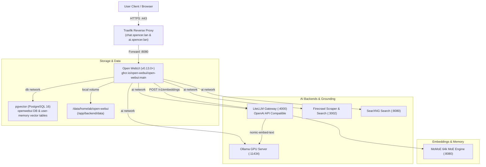

# Open WebUI Architecture & Operational Guide

This document provides architecture specifications, integration details, configuration parameters, and maintenance procedures for the **Open WebUI** service in Spencer's homelab.

---

## 📋 Overview

| Attribute | Specification |
|---|---|
| **Service Name** | `open-webui` |
| **Container Name** | `open-webui` |
| **Image** | `ghcr.io/open-webui/open-webui:main` (v0.13.0+) |
| **Role** | Multi-Model Generative AI Chat & Agent Client Interface |
| **Routing Domains** | `https://chat.spencer.lan` (Primary), `https://ai.spencer.lan` (Legacy Alias), `https://${OPENWEBUI_PUBLIC_DOMAIN}` |
| **Internal Port** | `8080` |
| **Database** | PostgreSQL 16 on `pgvector` container (DB: `openwebui`, isolated `db` network) |
| **Vector DB** | `pgvector` extension on PostgreSQL 16 (Collection: `user-memory-<user_id>`) |
| **Embedding Engine** | Offloaded to LiteLLM / Ollama (`nomic-embed-text`, 768-dim) |
| **Model Ingress** | Dual: LiteLLM Proxy (`http://litellm:4000/v1`) & Ollama (`http://ollama:11434`) |
| **Web Search Grounding** | Local Firecrawl Cluster (`http://firecrawl:3002`) & SearXNG (`http://searxng:8080`) |
| **Web Loader / Scraper** | Firecrawl Headless Cluster (`http://firecrawl:3002/v2/scrape`) |
| **Network Attachments**| `net1` (Traefik Ingress), `ai` (LiteLLM, Ollama, SearXNG, Firecrawl), `db` (pgvector) |
| **Persistent Storage** | `/data/homelab/open-webui` (`/app/backend/data` in container) |

---

## 🏗️ System Architecture



---

## 🧠 Memory Management & Cross-AI Synchronization

### 1. Zero-RAM In-Container Embedding Offload
By default, Open WebUI loads PyTorch and SentenceTransformer weights in memory (~500 MB–1 GB RAM). In our modernized configuration, embeddings are completely offloaded to LiteLLM:
* `RAG_EMBEDDING_ENGINE=openai`
* `RAG_OPENAI_API_BASE_URL=http://litellm:4000/v1`
* `RAG_OPENAI_API_KEY=${LITELLM_MASTER_KEY}`
* `RAG_EMBEDDING_MODEL=nomic-embed-text`

Open WebUI acts as a pure API client, retaining a minimal memory footprint (~350 MB) while vectorizing documents and user memories at GPU speeds.

### 2. Native Memory Architecture & Historical Migration
Open WebUI operates its own self-contained conversational memory engine backed directly by PostgreSQL on `pgvector`:
* **Native Memory Store**: User memories are stored in the `memory` table and vector-indexed directly using PostgreSQL's `pgvector` extension (`VECTOR_DB=pgvector`).
* **Historical Memory Migration**: All legacy procedural memories and conversational facts from retired memory servers (Memlord and Hindsight) were migrated into Open WebUI via [`scripts/import-memories-to-openwebui.py`](file:///data/homelab/scripts/import-memories-to-openwebui.py), establishing Open WebUI as the consolidated conversational memory system.
* **API Access**: Memories can be queried or managed via Open WebUI's REST API (`GET /api/v1/memories/`, `POST /api/v1/memories/query`).

---

## 🛠️ Configuration Parameters

Key environment variables in [`.env`](file:///data/homelab/.env) and [`docker-compose.yaml`](file:///data/homelab/docker-compose.yaml):

```bash
# Core Application
OPENWEBUI_VERSION=main
OPENWEBUI_SECRET_KEY=<secure-secret-key>
OPENWEBUI_PUBLIC_DOMAIN=ai.example.com

# PostgreSQL & pgvector
OPENWEBUI_POSTGRES_DB=openwebui
OPENWEBUI_POSTGRES_USER=openwebui
OPENWEBUI_POSTGRES_PASSWORD=<secure-password>
```

---

## 🔒 Security & Traefik Ingress

* **Middlewares**: Protected globally on Traefik entryPoint `websecure` with `geoblock@file` and `crowdsec-bouncer@file`.
* **TLS**: Traefik automatically terminates TLS using homelab wildcard certificates (`*.spencer.lan`) and Let's Encrypt for public WAN domains.
* **Authentication**: Native user authentication (`WEBUI_AUTH=True`) with email/password and role-based permissions (`admin`, `user`).

---

## 🔍 Health Checks & Operational Verification

```bash
# 1. Container health
docker compose ps open-webui

# 2. Local container health endpoint
docker exec open-webui curl -s http://localhost:8080/health

# 3. Traefik ingress check (LAN)
curl -kfsS https://chat.spencer.lan/health
curl -kfsS https://ai.spencer.lan/health

# 4. View memory entries in PostgreSQL
docker exec pgvector psql -U postgres -d openwebui -c "SELECT count(*) FROM memory;"

# 5. Query user memory via REST API
curl -s -H "Authorization: Bearer <OPENWEBUI_API_KEY>" https://chat.spencer.lan/api/v1/memories/
```

