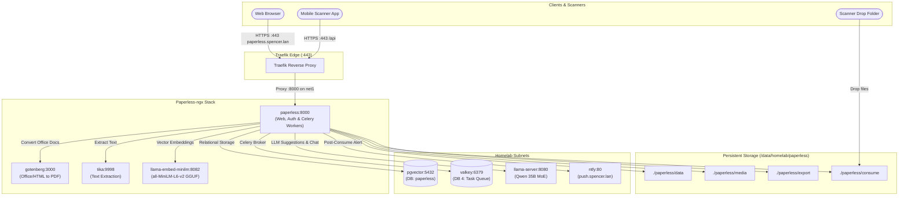

# Paperless-ngx - Document Management, OCR & Archival System

**Paperless-ngx** ([GitHub](https://github.com/paperless-ngx/paperless-ngx) / [docs.paperless-ngx.com](https://docs.paperless-ngx.com)) is an open-source, community-supported document management system that transforms physical documents into a searchable online archive with automated OCR, metadata tagging, full-text indexing, and native AI integration.

---

## 🎯 Overview & Architecture

* **Role**: Centralized document ingestion, OCR parsing, multi-format conversion, vector indexing, and archival retrieval system for Spencer's homelab.
* **Containers**:
  * `paperless`: Core Web UI, Django REST API, Celery background workers, and Celery beat scheduler.
  * `llama-embed-minilm`: Dedicated CPU AVX-512 vector embedding server running `all-MiniLM-L6-v2.gguf` via `llama.cpp`.
  * `gotenberg`: Headless Chromium and LibreOffice document conversion service (`.docx`, `.xlsx`, `.pptx`, `.eml` to PDF).
  * `tika`: Apache Tika text and metadata extraction service.
* **User**: `"${PUID:-1000}:${PGID:-1000}"` (`suadmin:suadmin`)
* **Networks**:
  * `net1`: Edge reverse proxy network connecting Traefik to Paperless for web and API access.
  * `db`: Dedicated database network communicating with `pgvector` on port `5432` (`database: paperless`).
  * `redis`: Dedicated cache network communicating with Valkey on port `6379` (DB 4: Celery task broker & cache).
  * `paperless-internal`: Isolated internal bridge network connecting Paperless to Gotenberg (:3000) and Tika (:9998).
  * `ai`: Private inter-service AI network connecting Paperless to `llama-server` (:8080) for generative metadata suggestions/chat, `llama-embed-minilm` (:8082) for semantic vector embeddings, and `ntfy` (:80) for ingestion alerts.
* **Ingress & URLs**:
  * Primary URL: `https://paperless.spencer.lan` (TLS via local wildcard certificate)
  * Secondary Alias: `https://docs.spencer.lan`
  * Internal Direct Endpoint: `http://paperless:8000`
* **Authentication**:
  * **Native Authentication**: Paperless-ngx built-in authentication system with local user accounts, session cookies, password management, and REST API tokens. ForwardAuth proxy middleware is not used, enabling full native control over users, permissions, and mobile scanner app integrations.
  * **API & Mobile Scanners**: Direct API token and basic auth support for mobile scanner applications (Paperless Mobile, QuickScan) and automated ingest pipelines.



---

## 📂 Storage & Directory Layout

All stateful persistent data resides on the 492GB host filesystem at `/data/homelab/paperless/`:

| Directory | Mount Target in Container | Purpose |
|---|---|---|
| `./paperless/consume` | `/usr/src/paperless/consume` | Ingestion watch folder. Files dropped here are parsed by inotify and consumed. |
| `./paperless/data` | `/usr/src/paperless/data` | Application index, search indexes, classification models, and database cache. |
| `./paperless/media` | `/usr/src/paperless/media` | Original archived documents, thumbnails, and OCR-rendered searchable PDFs. |
| `./paperless/export` | `/usr/src/paperless/export` | Destination folder for automated or manual document export backups. |
| `./paperless/scripts` | `/usr/src/paperless/scripts` | Custom automation scripts (e.g., `post-consume-ntfy.sh`). |

---

## 🤖 Native AI Subsystem Configuration

Paperless-ngx utilizes its native **AI Configuration Subsystem** (`PAPERLESS_AI_*`) wired to local homelab models:

### 1. LLM Suggestions & Document Chat
* **Backend**: `openai-like`
* **Endpoint**: `http://llama-server:8080/v1`
* **Model**: `qwen3.6-35b-a3b` MoE (GPU + host RAM via `--n-cpu-moe`)
* **Capabilities**:
  * **Automatic Document Metadata**: Evaluates OCR text to automatically suggest Title, Date, Correspondent, Document Type, and Tags.
  * **Document Chat**: Enables interactive Q&A in the web UI for any uploaded document.

### 2. Semantic Vector Embeddings
* **Backend**: `openai-like`
* **Endpoint**: `http://llama-embed-minilm:8082/v1`
* **Model**: `all-MiniLM-L6-v2` (`all-MiniLM-L6-v2-Q8_0.gguf`)
* **Runtime**: Dedicated `llama.cpp:server-cuda` container running with zero VRAM on CPU with mean pooling (`--pooling mean`).
* **Capabilities**:
  * Generates 384-dimensional dense semantic vectors for each document.
  * Powers semantic search and finds similar documents across the archive.

---

## 🔔 Integrations

### ntfy Document Alerts
A post-consumption hook is deployed at [`/data/homelab/paperless/scripts/post-consume-ntfy.sh`](file:///data/homelab/paperless/scripts/post-consume-ntfy.sh). Whenever a document is successfully processed, an alert is sent to `https://push.spencer.lan/paperless` with document title and a direct clickable URL.

### Homepage Dashboard
Paperless-ngx is integrated into [`homepage/config/services.yaml`](file:///data/homelab/homepage/config/services.yaml) under **Productivity & Documents** for quick access and health monitoring.

---

## 🛠️ Operational Commands

### Creating an Administrative Superuser
```bash
docker compose exec -it paperless python3 manage.py createsuperuser
```

### Document Exporter Backup
To export all documents and metadata into `./paperless/export`:
```bash
docker compose exec -it paperless document_exporter ../export
```

### Manual Index Rebuild
```bash
docker compose exec -it paperless document_index reindex
```

### Viewing Logs
```bash
docker compose logs -f paperless
docker compose logs -f llama-embed-minilm
docker compose logs -f gotenberg
docker compose logs -f tika
```
